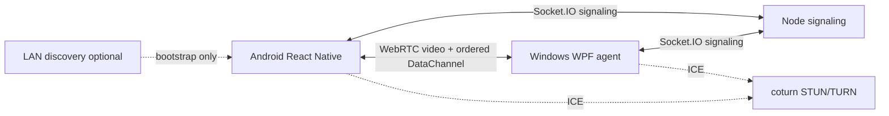

# Architecture

The Android client and Windows agent authenticate to the signaling service, which
relays only pairing, session, SDP, ICE, presence, and teardown messages. Screen
video and keyboard events travel over WebRTC; TURN is used when direct LAN/NAT
connectivity fails.

The agent visibly exposes pairing, consent, active-session state, and immediate
disconnect. No input is injected unless the device is paired, the agent is enabled,
the session is active, and local consent is present.
