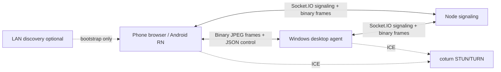

# Architecture

The Android client and Windows agent authenticate to the signaling service, which
relays pairing, session, presence, and teardown messages. Screen video travels as
binary JPEG frames over Socket.IO (`desktop.frame` with ArrayBuffer payload), and
keyboard/pointer events travel as JSON control messages (`desktop.control`). TURN
is used when direct LAN/NAT connectivity fails; WebRTC direct-connect is a future
phase.

Realtime optimizations:
- Binary frame transport (no base64 overhead) for screen video
- Adaptive capture framerate (low/balanced/high) driven by measured RTT
- requestAnimationFrame double-buffered rendering on the client
- Coalesced pointer input at ~60 fps with 16 ms throttle
- RTT-based congestion signaling and backpressure-aware frame dropping
- Connection quality indicator in the UI

The agent visibly exposes pairing, consent, active-session state, and immediate
disconnect. No input is injected unless the device is paired, the agent is enabled,
the session is active, and local consent is present.
